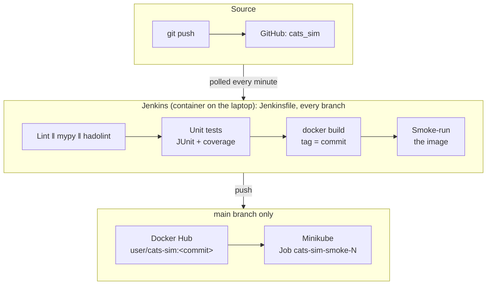

# Assignment 5, Part 2: CI/CD Pipeline for the CATS Simulator with Docker, Jenkins and Minikube

**Author:** Diyas Nurullayev · **Group:** CSE-2507M · **Course:** Applied Software Development Project · **Date:** October 2026

| What | Where |
| --- | --- |
| Repository | <https://github.com/PrimeraAizen/cats_sim> |
| Jenkinsfile | <https://github.com/PrimeraAizen/cats_sim/blob/main/Jenkinsfile> |
| Dockerfile | <https://github.com/PrimeraAizen/cats_sim/blob/main/Dockerfile> |
| Jenkins server as code | [`jenkins/`](https://github.com/PrimeraAizen/cats_sim/tree/main/jenkins) |
| Kubernetes manifests | [`k8s/`](https://github.com/PrimeraAizen/cats_sim/tree/main/k8s) |
| Docker Hub image | <https://hub.docker.com/r/DOCKERHUB_USER/cats-sim> |
| Design decision record | [ADR 0011](https://github.com/PrimeraAizen/cats_sim/blob/main/docs/adr/0011-docker-jenkins-minikube.md) |

## 1. Overview

The project is the **CATS Tangle Simulator**, a Python 3.14 research tool. It
simulates tip selection algorithms on a DAG-based ledger and produced the results of
the CATS paper. It already had a locked environment (`uv.lock`), 193 pytest tests and
GitHub Actions. This assignment added a Docker image and a self-hosted Jenkins
pipeline. The pipeline tests every commit, builds the image and, for `main`, publishes
it to Docker Hub and deploys it to a local Kubernetes cluster (Minikube).

## 2. Steps

1. **Containerisation.** The `Dockerfile` has two stages:
   - The builder (`uv:0.13.1-python3.14-trixie-slim`) installs the locked
     dependencies in a cached layer, then installs the project as a wheel.
   - The runtime (`python:3.14-slim-trixie`) receives only the virtual environment and
     `configs/`, and runs as uid 10001 with `ENTRYPOINT ["cats-sim"]`.

   An allow-list `.dockerignore` keeps tests, docs and secrets out of the build context.
   The image is 313 MB and runs the smoke experiment suite in about 1 s. It also works
   with a read-only root file system and all capabilities dropped. Hadolint reports no
   findings.

2. **Jenkins server.** `jenkins/` defines the server as code. It contains:
   - a Dockerfile with pinned Jenkins LTS 2.580.1, the docker CLI, kubectl v1.37.1
     (checksum-verified), uv and a pre-installed Python 3.14;
   - `plugins.txt`;
   - `casc.yaml` (Configuration as Code), which creates the admin user, the
     `dockerhub` and `kubeconfig` credentials, and a **multibranch pipeline job**
     through Job DSL;
   - `docker-compose.yml`;
   - `bootstrap.sh`, which prepares Kubernetes and the secrets and starts everything
     with one command.

   No setup wizard and no clicking are needed.

3. **CI pipeline** (`Jenkinsfile`). Durations are from a verification run of the
   real Jenkinsfile on a branch:

   | Stage | Runs on | Duration |
   | --- | --- | --- |
   | Set up: `uv sync --locked` | all branches | 27 s (cold cache) |
   | Quality: Ruff ‖ mypy ‖ hadolint, in parallel | all branches | 3 s |
   | Unit tests: 193 tests, coverage 97.3% (gate 85%), JUnit + coverage reports | all branches | 13 s |
   | Build image, tagged with the commit | all branches | 10 s |
   | Smoke-test image: read-only, no capabilities | all branches | 2 s |
   | Push to Docker Hub: `:<commit>` and `:latest` | `main` | DURATION |
   | Deploy to Minikube: Job must complete | `main` | DURATION |

   The whole branch build took **57 s**. Push and Deploy show as *skipped* on other
   branches.

4. **Docker Hub (optional item).** The pipeline logs in with an access token stored
   as a Jenkins credential. The login uses `--password-stdin` and a per-build
   `DOCKER_CONFIG`, so it never outlives the build. The pipeline pushes
   `DOCKERHUB_USER/cats-sim:<commit>` and `:latest`.

5. **CD to Kubernetes (bonus).** The Kubernetes setup has three parts:
   - The `cats-sim` namespace enforces the *restricted* Pod Security Standard.
   - Jenkins deploys as the `jenkins-deployer` ServiceAccount, which may only manage
     Jobs and read pods and logs in that namespace.
   - For every `main` build, the pipeline creates the Job `cats-sim-smoke-<build>` from
     `k8s/job.yaml`. The Job runs the image just pushed, as non-root, with a read-only
     file system and resource limits. The pipeline waits for it and prints its log,
     and the build fails unless the Job completes. The Job's annotations record the
     commit and the Jenkins build URL.

6. **GitHub Actions** remain the CI for pull requests. A new `docker` job lints, builds
   and smoke-runs the image, so the Dockerfile is checked even when the laptop Jenkins
   is off. Dependabot now also updates the base images.

## 3. Screenshots

| Figure | Shows |
| --- | --- |
|  | Fig. 1. Multibranch job with the discovered branches |
|  | Fig. 2. Green `main` build: all stages incl. Push and Deploy |
|  | Fig. 3. Feature-branch build: Push and Deploy skipped |
|  | Fig. 4. JUnit test result (193 passed) and coverage report |
|  | Fig. 5. Docker Hub repository with commit and `latest` tags |
|  | Fig. 6. `kubectl -n cats-sim get jobs,pods` and the Job log |
|  | Fig. 7. A failing test stops the pipeline before the image is built |

## 4. Difficulties and solutions

| Difficulty | Solution |
| --- | --- |
| Jenkins in a container must build images, but the Docker socket inside the container is `root:root 0660`. | Mount the host socket (Docker-outside-of-Docker) and add the `jenkins` user to the socket's group (`group_add`, GID detected by `bootstrap.sh`). |
| A Jenkins on a laptop cannot receive GitHub webhooks. | The multibranch job polls the repository every minute. A tunnel (ngrok, smee.io) would expose Jenkins to the internet. |
| The Kubernetes API of Minikube is published only on the host's `127.0.0.1`, which the Jenkins container cannot reach. | Jenkins joins the `minikube` Docker network and uses `https://<minikube ip>:8443`. That IP is in the API server certificate. |
| Secrets passed as environment variables can be printed by any `sh 'env'` step. | Secrets are files in a git-ignored `jenkins/secrets/` directory, mounted read-only at `/run/secrets` and read by Configuration as Code. |
| Giving Jenkins minikube's admin kubeconfig would mean cluster-admin rights. | A namespaced ServiceAccount with a minimal Role. A token generated by `bootstrap.sh` is the only cluster credential Jenkins holds. |
| The venv's interpreter path must exist in the runtime stage. | Builder and runtime use the same Python 3.14 / Debian trixie base. |
| Hadolint flagged named `USER`s (DL3066). Dockerfiles do not allow a comment after an instruction, so `USER 1000  # jenkins` would set a wrong user. | Use numeric UIDs, with the comment on its own line. |
| Dependabot cannot update `FROM` lines built from `ARG`s. | Image tags in `FROM` are literal. |
| Testing the pipeline before the first push. | The real Jenkinsfile was run against a local snapshot of the repository in a throwaway Jenkins. |
| Images built on an Apple-silicon Mac are arm64-only. | Fine for Minikube on the same machine; `docker buildx --platform linux/amd64,linux/arm64` would publish both. |

## 5. Conclusions

The pipeline turns every commit into evidence. Tests and coverage run on every
branch, the result is an image tagged with the commit, and for `main` that exact image
is published and proven to run on Kubernetes. The infrastructure is also code
(`Dockerfile`, `Jenkinsfile`, `jenkins/casc.yaml`, `k8s/`), so the environment can be
rebuilt on another machine with `jenkins/bootstrap.sh` and reviewed like any other
change. For a research tool this is the main gain: anyone can reproduce the
experiments with a single `docker run` of a known image, without setting up Python.
The main lesson was that most of the work is in the *connections* between tools:
socket permissions, network reachability, credentials and their scope. Testing the
pipeline locally before pushing saved several broken builds.
